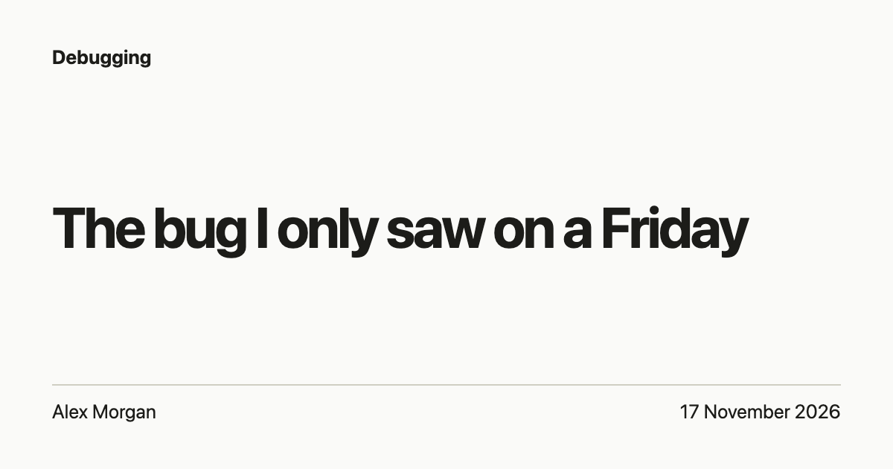

# Blog thumbnail

A small agent skill by [Nick Dimitratos](https://ndimitratos.com/about). Give it a blog post’s title, author, category and publication date. It returns a **1200 × 630 PNG** for link previews and an **editable HTML file**.

I built this example for [Why I Made an AI Skill for My Blog Thumbnails](https://ndimitratos.com/articles/why-i-made-an-ai-skill-for-my-blog-thumbnails/). The article shows the cover and Instagram Story I use on my site. This starter makes the landscape cover with system fonts; it needs no access to my portfolio.

## Try it

1. Copy [SKILL.md](SKILL.md) and [template.html](template.html) into a folder named `blog-thumbnail` in your project. Keep them together.
2. Give the prompt below to a coding agent that can edit local files and take a browser screenshot. No package installation is needed for the template.
3. Open the returned `thumbnail.png`. Check that the title fits above the footer. To adjust the design yourself, open the returned `thumbnail.html` in an editor.

> Follow blog-thumbnail/SKILL.md. My post is “The bug I only saw on a Friday”, by Alex Morgan, filed under Debugging, dated 17 November 2026. Make a thumbnail and show me the result.

